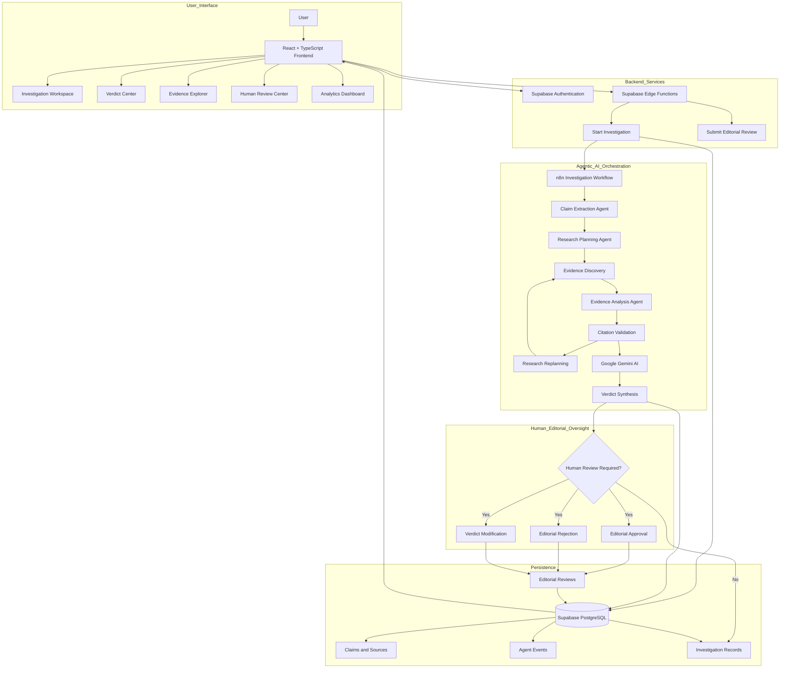
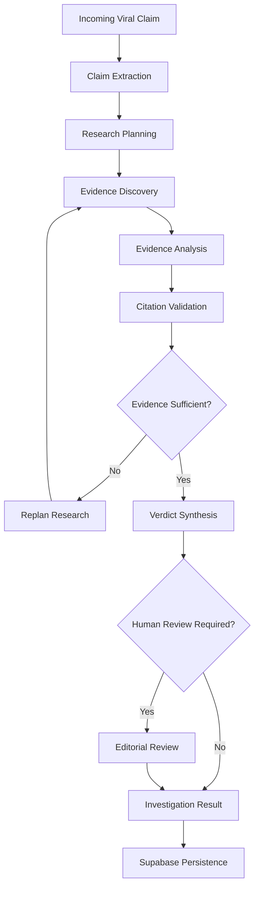
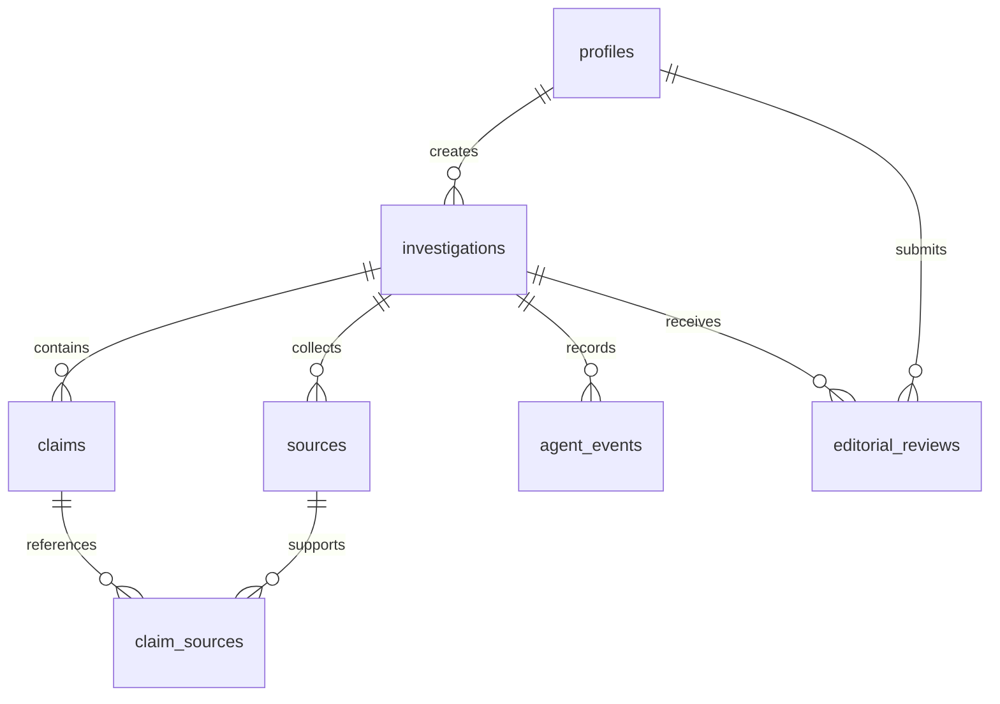

<div align="center">

</div>

# Run and deploy your AI Studio app

This contains everything you need to run your app locally.

View your app in AI Studio: https://ai.studio/apps/cf5e89fe-7298-4e43-a763-d118acd6b51a

## Run Locally

**Prerequisites:**  Node.js


1. Install dependencies:
   `npm install`
2. Set the `GEMINI_API_KEY` in [.env.local](.env.local) to your Gemini API key
3. Run the app:
   `npm run dev`

# VERITAS AI — Cognitive Fact-Checking & Misinformation Investigation Platform

> **Verify. Investigate. Analyze. Review. Establish the Truth.**  
> An Agentic AI-powered misinformation investigation platform.

**VERITAS AI** is an AI-powered fact-checking and misinformation investigation platform. It uses Google Gemini and n8n-based agent orchestration to extract factual claims, investigate supporting and contradicting evidence, evaluate source credibility, validate citations, rank investigation conclusions, and generate explainable fact-checking reports.

The platform combines autonomous AI investigation, evidence-based reasoning, iterative research, Supabase persistence, and mandatory human editorial oversight for cases requiring additional verification.

---

## 1. System Architecture



### Architecture Layers

| Layer | Technology | Responsibility |
|---|---|---|
| Presentation | React, TypeScript | Investigation interface and dashboards |
| Authentication | Supabase Auth | User identity and authentication |
| Backend | Supabase Edge Functions | Request processing and server-side operations |
| AI Processing | Google Gemini | Claim analysis and evidence-based reasoning |
| Orchestration | n8n | Multi-stage autonomous investigation |
| Database | PostgreSQL | Investigation and evidence persistence |
| Security | Supabase RLS | Database access control |
| Editorial Oversight | Human-in-the-Loop | Review and approval of investigation outcomes |

---

## 2. Design System & Visual Identity

VERITAS AI uses a premium enterprise SaaS interface inspired by modern AI investigation and analytics platforms.

- **Primary Background:** Deep Navy (`#0F172A`)
- **Secondary Background:** Dark Blue (`#1E293B`)
- **Primary Brand Color:** Navy Blue (`#0B3D91`)
- **Secondary Accent:** Emerald (`#10B981`)
- **Highlight Accent:** Saffron (`#F59E0B`)
- **Main Text:** Soft White (`#F8FAFC`)
- **Secondary Text:** Slate Gray
- **Typography:** Jakarta Sans and Inter

### Interface Design Principles

- Professional enterprise dashboard.
- Clear investigation workflow visualization.
- Evidence-focused information presentation.
- Consistent verdict and risk indicators.
- Responsive layouts.
- Accessible user interactions.
- Clear distinction between AI results and human decisions.

---

## 3. Core Investigation Capabilities

### Investigation Workspace

- Submit viral social media posts.
- Analyze controversial news claims.
- Investigate forwarded messages.
- Process source statements.
- Select source platforms.
- Provide author and source context.

Supported source categories include X/Twitter, TikTok, Facebook, Reddit, Telegram, and News Articles.

### Autonomous AI Investigation

- Automated factual claim extraction.
- Intelligent research planning.
- Evidence discovery.
- Supporting and contradicting evidence analysis.
- Source credibility evaluation.
- Citation validation.
- Iterative research and replanning.
- Explainable verdict generation.

### Evidence Explorer

- Supporting evidence.
- Contradicting evidence.
- Source information.
- Citation references.
- Evidence relevance.
- Source credibility indicators.

### Verdict Center

- Overall investigation verdict.
- Individual claim verdicts.
- Credibility indicators.
- Misinformation risk.
- Executive investigation summary.
- Evidence-backed explanations.

### Agent Loop Viewer

Visualizes the autonomous investigation lifecycle:

`PLAN → ACT → OBSERVE → REPLAN → SYNTHESIZE`

### Human-in-the-Loop Review

- Editorial review of uncertain cases.
- Reviewer notes.
- Claim-level verdict modifications.
- Approve, reject, and modify decisions.
- Authorized reviewer access.
- Review history.

### Investigation Archive

- Historical investigation records.
- Investigation status.
- Previous verdicts.
- Investigation summaries.

### Analytics Dashboard

- Investigation statistics.
- Verdict distribution.
- Misinformation risk indicators.
- Agent execution metrics.
- Investigation activity.

### n8n Integration Hub

- Workflow integration visibility.
- Production webhook integration.
- Automated investigation triggering.
- AI workflow coordination.
- Human-review orchestration.

---

## 4. AI Agent Workflow

VERITAS AI follows a structured, multi-stage agentic investigation process.



### Agent Responsibilities

| Stage | Agent Responsibility |
|---|---|
| Claim Extraction | Identifies individual factual claims |
| Research Planning | Develops a structured verification strategy |
| Evidence Discovery | Finds relevant information and sources |
| Evidence Analysis | Evaluates supporting and contradicting evidence |
| Citation Validation | Checks evidence and citation consistency |
| Research Replanning | Requests additional research when evidence is insufficient |
| Verdict Synthesis | Generates an explainable investigation assessment |
| Human Review | Escalates cases requiring editorial judgment |

### Investigation Loop

1. **PLAN:** Determine what needs verification.
2. **ACT:** Execute research and evidence discovery.
3. **OBSERVE:** Examine retrieved evidence and results.
4. **REPLAN:** Perform additional research when required.
5. **SYNTHESIZE:** Generate the final investigation assessment.

The workflow is designed to support multiple investigation iterations rather than relying on a single AI-generated response.

---

## 5. Security & Human-in-the-Loop Principles

VERITAS AI incorporates security and editorial accountability into its architecture.

1. **Evidence-Based Conclusions:** Investigation conclusions should be supported by traceable evidence.
2. **Citation Integrity:** Evidence references must correspond to actual retrieved sources.
3. **Human Editorial Oversight:** Uncertain cases can be escalated for human review.
4. **Role-Based Authorization:** Administrative and editorial operations require authorized roles.
5. **Database Isolation:** PostgreSQL Row Level Security controls access to investigation records.
6. **Server-Side Privileged Operations:** Service-role credentials must never be exposed to frontend clients.
7. **Input Validation:** Incoming investigation and review requests are validated.
8. **Auditability:** Investigation events and editorial decisions are recorded.
9. **Uncertainty Handling:** Inconclusive evidence should not be presented as a verified conclusion.

### Editorial Review Decisions

| Decision | Purpose |
|---|---|
| `APPROVED` | Approve the investigation outcome |
| `REJECTED` | Reject the investigation outcome |
| `MODIFIED` | Record a modified investigation outcome |

### Escalation Conditions

Human review may be required when:

- AI confidence falls below the configured threshold.
- Evidence sources contradict each other.
- A claim remains unverified.
- Citation validation fails.
- Investigation processing encounters errors.
- Additional editorial judgment is necessary.

---

## 6. Environment Variables & Setup

### Environment Variables

Create an environment configuration based on the variables required by your project.

```bash
# Gemini AI - Server Side Only
GEMINI_API_KEY=

# Supabase Configuration
SUPABASE_URL=
SUPABASE_ANON_KEY=
SUPABASE_SERVICE_ROLE_KEY=

# Frontend Supabase Configuration
VITE_SUPABASE_URL=
VITE_SUPABASE_ANON_KEY=

# n8n Integration
N8N_WEBHOOK_URL=
```

**Security requirements:**

- Never commit `.env` files.
- Never expose `SUPABASE_SERVICE_ROLE_KEY` in frontend code.
- Never expose private Gemini API keys in frontend code.
- Store server-side credentials in Supabase Edge Function Secrets.
- Keep webhook and authentication secrets private.
- Use the actual environment variable names expected by your application.

### Installation & Run

```bash
# 1. Clone the repository
git clone https://github.com/YOUR-GITHUB-USERNAME/veritas-ai.git

# 2. Navigate into the project
cd veritas-ai

# 3. Install dependencies
npm install

# 4. Start development server
npm run dev

# 5. Build the project
npm run build
```

Use the scripts defined in `package.json`. If the project uses a separate Express production server, follow its configured production start command.

### Supabase Configuration

1. Create a Supabase project.
2. Configure project authentication.
3. Apply the SQL migration files.
4. Enable Row Level Security.
5. Configure database policies.
6. Deploy the required Edge Functions.
7. Configure server-side environment secrets.
8. Verify authenticated database access.

### n8n Configuration

1. Import or open the VERITAS AI investigation workflow.
2. Configure the Webhook node.
3. Configure Gemini and research integrations.
4. Configure claim extraction and evidence analysis.
5. Configure citation validation.
6. Configure research replanning.
7. Configure human-review escalation.
8. Publish the workflow.
9. Add the production webhook URL to Supabase Edge Function Secrets.

**Production Webhook Path:**

```text
POST /webhook/veritas-factcheck
```

---

## 7. Database Migrations & Schemas

VERITAS AI uses Supabase PostgreSQL for investigation persistence, evidence management, and editorial review.

The initial database schema contains seven core relational tables.

| No. | Table | Responsibility |
|---|---|---|
| 1 | `profiles` | User profiles and role information |
| 2 | `investigations` | Main investigation records |
| 3 | `claims` | Extracted factual claims |
| 4 | `sources` | Evidence source information |
| 5 | `claim_sources` | Claim-to-source relationships |
| 6 | `agent_events` | AI agent execution history |
| 7 | `editorial_reviews` | Human review decisions and notes |

### Database Relationships



### Investigation Statuses

- `queued`
- `in_progress`
- `completed`
- `review_pending`
- `approved`
- `rejected`
- `failed`

### Claim Verdicts

- `TRUE`
- `MOSTLY_TRUE`
- `MIXED`
- `MISLEADING`
- `FALSE`
- `UNVERIFIABLE`

### Overall Verdicts

- `VERIFIED`
- `SUBSTANTIALLY_TRUE`
- `MIXED_ACCURACY`
- `HIGHLY_MISLEADING`
- `FABRICATED`
- `INCONCLUSIVE`

---

## 8. REST API Reference

The application includes a Supabase Edge Function integration and an Express backend in its original project architecture.

### Investigation Integration

| Function / Endpoint | Method | Description |
|---|---|---|
| `start-investigation` | POST | Validates and starts an investigation |
| `submit-editorial-review` | POST | Processes authorized editorial review decisions |
| `/api/investigate` | POST | Original direct Gemini investigation path, if retained |
 
### Backend API

The original project also contains an Express server. The following endpoint is part of the original direct investigation architecture:

| Endpoint | Method | Description |
|---|---|---|
| `/api/investigate` | POST | Direct Gemini investigation path, if enabled |

**Important:** Verify the current `server.ts` and deployed Edge Function routes before treating this as a complete production API reference. The n8n production webhook is an internal integration endpoint, not a public browser-facing API.

---

## 9. Example Investigation

### Sample Claim

"The Government of India has announced that every Indian citizen will receive ₹10,000 directly into their bank account starting next month."

### Investigation Process

1. Receive the submitted statement.
2. Extract the central government-benefit claim.
3. Create a research plan.
4. Search for relevant official government announcements.
5. Collect supporting and contradicting evidence.
6. Analyze source credibility.
7. Validate citations.
8. Generate an evidence-based assessment.
9. Escalate the case for human review if required.
10. Store the investigation record and results.

This is an illustrative test claim, not a verified government announcement.

---

## 10. Automated Testing & Validation

VERITAS AI includes investigation workflow components that should be validated through functional, integration, security, and end-to-end tests.

### Recommended Test Scenarios

| Test ID | Test Scenario | Expected Result |
|---|---|---|
| VER-01 | Submit a valid investigation | Investigation request accepted |
| VER-02 | Submit an empty claim | Validation error |
| VER-03 | Submit a claim below minimum length | Validation error |
| VER-04 | Create investigation record | Record persisted in Supabase |
| VER-05 | Trigger n8n workflow | Production webhook receives request |
| VER-06 | Extract factual claims | Structured claims generated |
| VER-07 | Retrieve investigation evidence | Relevant evidence collected |
| VER-08 | Validate citations | Invalid or unsupported citations identified |
| VER-09 | Generate investigation verdict | Structured verdict returned |
| VER-10 | Submit unauthorized editorial review | Access denied |
| VER-11 | Submit authorized editorial review | Review decision recorded |
| VER-12 | Verify investigation access | RLS restricts unauthorized access |

### Integration Test Results

A direct Supabase Edge Function test has successfully created an investigation record.

The test returned:

- A generated investigation ID.
- A saved investigation record.
- An initial `in_progress` status.

However, the n8n webhook returned HTTP 404 during the earlier integration test.

Therefore, successful end-to-end agent execution and final verdict generation remain to be verified.

---

## 11. Current Development Status

| Component | Status |
|---|---|
| React + TypeScript frontend | Implemented |
| Investigation Workspace | Implemented |
| Verdict Center | Implemented |
| Evidence Explorer | Implemented |
| Agent Loop Viewer | Implemented |
| Human Review interface | Implemented |
| Investigation Archive | Implemented |
| Analytics Dashboard | Implemented |
| Supabase database schema | Created |
| Supabase RLS policies | Configured; access testing required |
| `start-investigation` Edge Function | Deployed and directly tested |
| Investigation database insertion | Successfully tested |
| n8n investigation workflow | Published |
| Production webhook | Configured; integration testing ongoing |
| Gemini agent execution | Workflow designed; production execution not yet confirmed |
| Editorial review Edge Function | Updated; deployment and testing pending |
| Full end-to-end investigation | Pending verification |

---

## 12. Known Limitations

- Investigation results depend on the quality, relevance, and availability of retrieved sources.
- AI-generated conclusions require evidence validation and appropriate uncertainty handling.
- n8n webhook integration requires successful production endpoint configuration.
- Long-running investigations require asynchronous execution and reliable status updates.
- Human editorial review requires authenticated and authorized reviewers.
- Database access depends on correctly configured RLS policies.
- Successful investigation record creation does not prove that the complete AI workflow has executed.
- Production readiness requires end-to-end integration, security, and reliability testing.

---

## 13. Future Enhancements

### Advanced AI Investigation
- Improved multilingual claim verification.
- Advanced source credibility scoring.
- More reliable citation validation.
- Improved research planning.
- Better evidence ranking.

### Multimedia Fact-Checking
- OCR-based image verification.
- Video misinformation analysis.
- Audio and speech claim verification.
- Document-based claim extraction.

### Enterprise Capabilities
- Advanced editorial collaboration.
- Investigation benchmarking.
- Improved monitoring and observability.
- Expanded official-source integrations.
- Scalable background processing.
- Advanced analytics and reporting.

---

## 14. Project Vision

VERITAS AI aims to make digital information verification more accessible, transparent, and reliable.

By combining autonomous AI agents, evidence-driven investigation, transparent citations, and human editorial accountability, the platform moves beyond simple AI-generated answers toward structured and explainable fact-checking.

**Our principle: Trust should be supported by evidence, not simply generated by AI.**

---

## 15. Project Information

| Field | Details |
|---|---|
| Project Name | VERITAS AI |
| Category | Agentic AI |
| Domain | Fact-Checking and Misinformation Detection |
| AI Model | Google Gemini |
| Orchestration | n8n |
| Backend | Supabase Edge Functions |
| Database | PostgreSQL |
| Frontend | React + TypeScript |
| Repository | GitHub |
| Development Environment | Google AI Studio |

**GitHub Repository:** `https://github.com/YOUR-GITHUB-USERNAME/veritas-ai`

**Live Demo:** Add deployed application URL.

**Demo Video:** Add project demonstration URL.

**Presentation:** Add project presentation URL.

---

## 16. Acknowledgements

Built using modern AI technologies, workflow automation, open-source software, and cloud infrastructure.

Special thanks to the developer community and the platforms that make responsible AI innovation possible.

If you find this project interesting, consider starring the repository and sharing your feedback.

---

<p align="center">
  <strong>VERITAS AI — Verify Before You Believe.</strong>
</p>

<p align="center">
  Cognitive Fact-Checking & Misinformation Intelligence.
</p>
